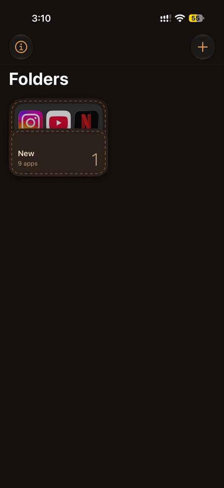
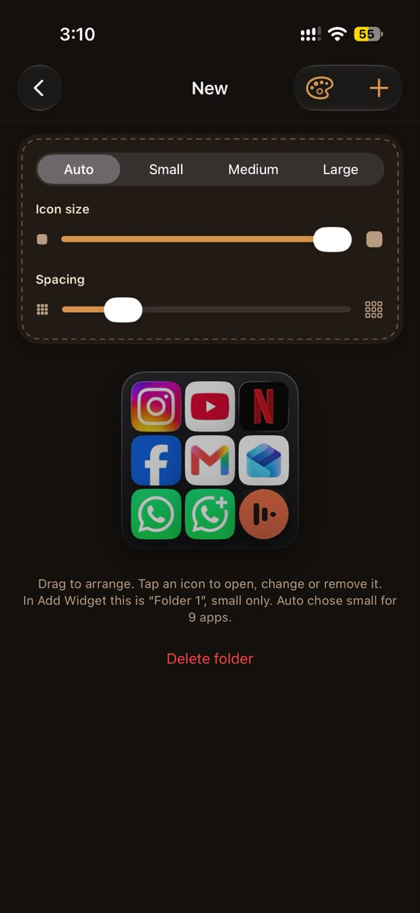
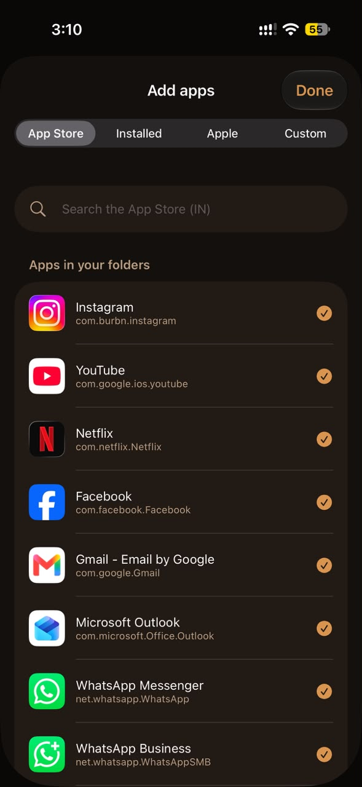
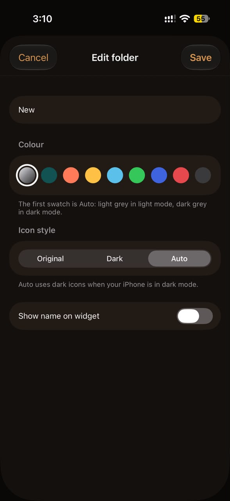

# Tuck


Tuck puts folders of apps on your iPhone Home Screen as widgets. Tap an icon in the widget and the app opens straight away: no folder to open first, no second tap.

- **Folders as widgets.** Up to six folders, each shown as a Small, Medium or Large widget (or Auto size).
- **One-tap launch.** Apps open by bundle ID straight from the widget.
- **Real icons.** Original App Store icons, Apple's own apps from the phone, or pick your own.
- **Sideloaded apps work too.** Anything installed on the phone can go in a folder.
- **No ads, nothing to buy.**

The app itself is where you shape the folders: drag apps into order, set icon size and spacing, and preview each widget exactly as it will look on the Home Screen.

## Screenshots

<p>
  
  
  
  
</p>

## Why it isn't on the App Store

Tuck uses private iOS APIs to open apps by bundle ID, check what's installed and read system icons. Apple doesn't allow that on the App Store, so Tuck can only be sideloaded and never will be on the store.

Requires iOS 18 or later.

## Install

1. Download `Tuck-x.y.z.ipa` from [Releases](../../releases).
2. Sign and install it with a sideloading tool such as [Sideloadly](https://sideloadly.io) or [AltStore](https://altstore.io), using your own Apple ID or certificate.
3. Open Tuck, make a folder and add apps.
4. On the Home Screen, add a Tuck widget. Widgets are named "Folder 1" to "Folder 6" and show your folders in the order they appear in the app.

## Build

The Xcode project is generated with [XcodeGen](https://github.com/yonaskolb/XcodeGen) from `project.yml`.

```bash
brew install xcodegen
xcodegen generate
open Tuck.xcodeproj
```

Pushing to `main` (or running the workflow by hand) builds an unsigned IPA on GitHub Actions with `.github/workflows/ios.yml`. Download it from the run's artifacts and sign it as above.

## License

[MIT](LICENSE)
